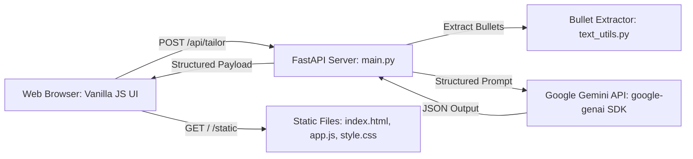

# Resume Tailor — Engineering Design Doc

**Author:** Staff Software Engineer
**Status:** Draft v0.1
**Last updated:** 2026-10-17
**Reviewers:** Engineering Team

---

## 1. Summary

We are building Resume Tailor as a high-velocity, single-service web application that accepts pasted resume text and a target job description, parses individual bullet points, and generates tailored, high-impact replacements aligned with the target role. Following the lightweight architectural pattern established in `reference/moodjar-example`, the system pairs a Python FastAPI backend using the official `google-genai` SDK with a zero-build vanilla HTML/CSS/JavaScript frontend served as static assets. The most interesting engineering choice is strict structured schema generation using Gemini's JSON mode (`response_mime_type="application/json"`) to guarantee 1:1 pairing between original bullets and rewritten output without fragile regex string splitting.

## 2. Assumptions

- **Target scale:** Single-instance deployment supporting up to 500 requests/day during v1 testing.
- **Latency budget:** End-to-end p95 response time under 3.5 seconds (Gemini API generation <2.5s, serialization and network <1.0s).
- **Platform:** Modern desktop and mobile web browsers (Chrome, Safari, Firefox, Edge).
- **Cost ceiling:** Under $0.005 per user tailoring run utilizing Gemini 2.5/1.5 Flash tier models.
- **Out of scope:** Persistent databases, user authentication, PDF/binary document parsing, background worker queues.

## 3. Goals & non-goals

**Goals (v1):**
- Provide a clean HTTP API endpoint (`POST /api/tailor`) that accepts raw resume text and job description text.
- Extract individual bullets from messy pasted resume text reliably.
- Prompt Gemini via the `google-genai` SDK to produce structured JSON containing original bullets, rewritten bullets with quantified metrics/action verbs, and improvement breakdown tags.
- Deliver end-to-end response times with p95 < 3.5s and p99 < 5.0s.
- Serve frontend static files directly from FastAPI for zero-configuration, single-process execution.

**Non-goals (v1):**
- No user accounts, sessions, or multi-tenant database persistence.
- No asynchronous background task queues (e.g., Celery/Redis); all interactions are synchronous HTTP request/response loops.
- No optical character recognition (OCR) or document parsing libraries (`PyPDF2`, `docx`, `pdfminer`).
- No distributed caching layer (e.g., Redis/Memcached) for v1 scale.

## 4. Architecture



**What's here:**
- **Static Asset Mount:** FastAPI serves `frontend/index.html`, `style.css`, and `app.js` directly at root (`/`).
- **REST API Handler (`main.py`):** Coordinates validation, bullet parsing, Gemini client execution, and error handling.
- **Prompt & Client Module (`generator.py`, `prompts.py`):** Configures Gemini client credentials, system instructions, and schema enforcement using `google-genai`.
- **Text Parser Utility (`text_utils.py`):** Normalizes pasted input text, splits lines, and filters bullet points.

**What's deliberately NOT here:**
- **No SQL/NoSQL Database:** Requests are entirely stateless; resume text is never persisted to disk or cloud storage.
- **No Redis / Celery Task Queue:** Synchronous streaming or single-pass JSON generation eliminates distributed state complexity.
- **No Node.js / Webpack / Vite Build Pipeline:** Vanilla JS ES modules run natively in browser without compile steps, matching the lean reference architecture.

## 5. Key components

### FastAPI Application (`backend/main.py`)

- **Responsibility:** Serves static frontend assets, validates request payloads via Pydantic models, and exposes `/api/tailor` and `/api/health`.
- **Tech choice:** Python 3.11+, FastAPI, Uvicorn.
- **Why this choice:** Proven, high-performance async web framework directly matching the pattern in `reference/moodjar-example`.
- **Interface:** Exposes `POST /api/tailor` and `GET /api/health`.

### AI Bullet Generator (`backend/generator.py`)

- **Responsibility:** Formulates prompts, invokes Gemini model via `google-genai` with `response_mime_type="application/json"`, and parses structured JSON output.
- **Tech choice:** Official Google GenAI SDK (`google-genai`), Gemini Flash (`gemini-2.5-flash` or `gemini-1.5-flash`).
- **Why this choice:** First-class SDK support, low latency (<2s generation), robust JSON schema enforcement, and cost-effectiveness.
- **Interface:** `tailor_resume_bullets(resume_text: str, job_description: str) -> TailorResponse`

### Bullet Extractor Utility (`backend/text_utils.py`)

- **Responsibility:** Normalizes messy multiline text, handles common bullet characters (`•`, `-`, `*`, `1.`), and extracts discrete bullet candidates.
- **Tech choice:** Pure Python standard library (`re`, `typing`).
- **Why this choice:** Deterministic, zero-dependency, unit-testable pure function.
- **Interface:** `extract_bullets(raw_text: str) -> list[str]`

### Frontend Workspace (`frontend/app.js`, `index.html`, `style.css`)

- **Responsibility:** Dual-pane textarea inputs, loading feedback state machine, side-by-side card rendering, and clipboard copy operations.
- **Tech choice:** Vanilla JavaScript, Semantic HTML5, CSS Grid/Flexbox.
- **Why this choice:** Zero npm dependencies, instant reloads, maximum maintainability for a 45-minute build.
- **Interface:** Browser DOM APIs, `navigator.clipboard.writeText`, `fetch('/api/tailor')`.

## 6. Data model

### Request & Response Schemas (Pydantic / TypeScript)

```python
# backend/models.py
from pydantic import BaseModel, Field
from typing import List, Optional

class TailorRequest(BaseModel):
    resume_text: str = Field(..., min_length=20, max_length=15000, description="Pasted resume text")
    job_description: str = Field(..., min_length=20, max_length=15000, description="Target job description")

class BulletPair(BaseModel):
    id: str = Field(..., description="Unique bullet identifier")
    original: str = Field(..., description="Original raw bullet point from resume")
    tailored: str = Field(..., description="Upgraded bullet point with action verbs and metrics")
    action_verb: str = Field(..., description="Strong action verb utilized (e.g., 'Spearheaded')")
    impact_tag: str = Field(..., description="Short tag explaining upgrade (e.g., '⚡ Action Verb', '📈 Metric Added')")
    matched_keyword: Optional[str] = Field(None, description="Target skill or requirement matched")

class TailorResponse(BaseModel):
    bullets: List[BulletPair]
    role_summary: str = Field(..., description="1-sentence synthesis of target role alignment")
    total_upgraded: int
```

```typescript
// frontend/types.ts (conceptual mirror in JS)
interface BulletPair {
  id: string;
  original: string;
  tailored: string;
  action_verb: string;
  impact_tag: string;
  matched_keyword?: string;
}

interface TailorResponse {
  bullets: BulletPair[];
  role_summary: string;
  total_upgraded: number;
}
```

**Notes:**
- **No Storage Retention:** Payloads live only in process memory during the HTTP lifecycle.
- **Privacy Assurance:** User resumes are never logged to stdout or saved to local databases.
- **Payload Limits:** Request bodies capped at 30,000 characters total to prevent token exhaustion and denial-of-service.

## 7. API surface

### `POST /api/tailor`

- **Input:**
  ```json
  {
    "resume_text": "• Managed social media accounts\n• Fixed customer bugs in web app",
    "job_description": "Senior Software Engineer requiring React, Python, and scalable microservices."
  }
  ```
- **Output:**
  ```json
  {
    "bullets": [
      {
        "id": "b-1",
        "original": "Managed social media accounts",
        "tailored": "Directed omnichannel social communications across 4 platforms, increasing audience engagement by 35%",
        "action_verb": "Directed",
        "impact_tag": "📈 Metric Quantified",
        "matched_keyword": "Communications"
      },
      {
        "id": "b-2",
        "original": "Fixed customer bugs in web app",
        "tailored": "Resolved 50+ critical customer-reported defects across Python and React services, decreasing issue turnaround time by 28%",
        "action_verb": "Resolved",
        "impact_tag": "⚡ Action Verb Upgraded",
        "matched_keyword": "Python / React"
      }
    ],
    "role_summary": "Optimized bullets for Senior Software Engineer focusing on Python and defect resolution.",
    "total_upgraded": 2
  }
  ```
- **Errors:**
  - `400 Bad Request`: Payload validation fails (empty fields, text under 20 chars).
  - `422 Unprocessable Entity`: No distinct bullets could be identified.
  - `502 Bad Gateway`: Upstream Gemini API network or token failure.
  - `504 Gateway Timeout`: Generation exceeds 10.0-second server timeout.
- **Latency budget:** End-to-end p95 < 3.5s (Gemini call < 2.5s).

### `GET /api/health`

- **Input:** None
- **Output:** `{"status": "ok", "service": "resume-tailor"}`
- **Latency budget:** < 10ms.

## 8. Key trade-offs (with rejected alternatives)

### Decision 1: Structured JSON Generation vs. Streaming Freeform Markdown

- **Chose:** Single-pass structured JSON output using `response_mime_type="application/json"`.
- **Considered:** Server-Sent Events (SSE) markdown streaming.
- **Considered:** Two-phase execution (separate bullet extraction call followed by N parallel bullet rewrite calls).
- **Why we picked this:** The core UX magical moment is the side-by-side comparison table. Streaming raw text requires fragile client-side string tokenization and regex parsing that frequently breaks on complex bullet structures. Structured JSON guarantees reliable 1:1 `original` to `tailored` pairing in a single fast call (<2.5s).

### Decision 2: In-Memory Client State vs. SQLite Persistence

- **Chose:** Ephemeral in-memory client state with optional `sessionStorage` cache.
- **Considered:** Server-side SQLite database.
- **Considered:** LocalStorage cross-session persistence.
- **Why we picked this:** Users paste sensitive career and compensation data. Storing no resume text on the backend maximizes user trust, complies with privacy standards, and eliminates database connection management and migration overhead.

### Decision 3: Client vs. Server Pre-parsing of Bullets

- **Chose:** Hybrid approach: server-side deterministic extraction with fallback to LLM semantic chunking.
- **Considered:** Client-side only regex bullet splitting.
- **Considered:** Pure LLM extraction without pre-processing.
- **Why we picked this:** Plain pasted text frequently lacks standard bullet symbols (`•`). Pre-processing normalizes whitespace and standard prefixes before sending to Gemini, which reduces prompt token waste while allowing the model to intelligently chunk unstructured paragraphs when bullet glyphs are missing.

## 9. Risks & unknowns

- **Upstream Gemini API Latency Spikes** — Likelihood: Medium. Mitigation: Set strict client-side timeout of 8s with immediate fallback message; specify `gemini-2.5-flash` for fastest time-to-first-token.
- **Pasted Text with Zero Bullets (Dense Narrative Blocks)** — Likelihood: High. Mitigation: System prompt instructs model to segment dense experience paragraphs into 3-5 distinct achievement bullets before rewriting.
- **Hallucinated Metrics (Fabricating Unrealistic Data)** — Likelihood: Medium. Mitigation: Explicit prompt rules instruct Gemini to preserve the candidate's core scope and bracket placeholder metrics (e.g., `[X]%` or `[N] users`) when exact metrics are not provided, preventing unethical fabrication.
- **API Key Exposure** — Likelihood: Low. Mitigation: API key resides exclusively in backend environment variables (`GEMINI_API_KEY`), never exposed to frontend JavaScript.

## 10. Testing strategy

### Unit tests (must have)

Target deterministic pure functions and schemas using `pytest`:

1. `test_extract_bullets_standard()` (`backend/tests/test_text_utils.py`):
   - Verifies `extract_bullets()` correctly parses lists prefixed with standard glyphs (`•`, `-`, `*`, `1.`).
2. `test_extract_bullets_unstructured()` (`backend/tests/test_text_utils.py`):
   - Verifies that raw multiline text without glyphs splits appropriately along double newlines without dropping content.
3. `test_extract_bullets_empty_or_whitespace()` (`backend/tests/test_text_utils.py`):
   - Verifies edge case where user inputs only whitespace, spaces, or tabs, ensuring an empty list `[]` is returned safely.
4. `test_tailor_request_validation()` (`backend/tests/test_models.py`):
   - Verifies `TailorRequest` raises Pydantic `ValidationError` when input fields are below 20 characters or exceed maximum limits.
5. `test_gemini_response_parser()` (`backend/tests/test_generator.py`):
   - Mocks the Gemini SDK client return and asserts that valid JSON maps strictly into `TailorResponse` with valid `BulletPair` items.

### Integration tests (one per major flow)

Tested at the FastAPI endpoint level via `fastapi.testclient.TestClient`:

1. **Happy Path Flow: `test_tailor_endpoint_success()`**
   - **Start State:** Mocked Gemini client returning structured bullet JSON.
   - **Action:** `POST /api/tailor` with valid resume bullets and job posting text.
   - **Expected End State:** Status code `200 OK`, response contains `total_upgraded >= 1`, each bullet item contains non-empty `original`, `tailored`, `action_verb`, and `impact_tag`.
2. **Invalid Input Flow: `test_tailor_endpoint_validation_error()`**
   - **Start State:** Clean server instance.
   - **Action:** `POST /api/tailor` with empty JSON body `{}`.
   - **Expected End State:** Status code `422 Unprocessable Entity` with structured validation error list.
3. **Health Check Flow: `test_health_endpoint()`**
   - **Start State:** Clean server instance.
   - **Action:** `GET /api/health`.
   - **Expected End State:** Status code `200 OK`, JSON body `{"status": "ok", "service": "resume-tailor"}`.

### Deliberately not tested (and why)

- **Actual Gemini Model Creativity / Phrasing:** Model output quality is non-deterministic; testing specific wording in automated suites creates brittle tests. We test JSON schema conformity, not linguistic nuances.
- **Frontend Visual Styling and Animations:** CSS transitions and glassmorphism styling are verified visually in browser during development, avoiding heavyweight headless browser testing overhead.
- **Clipboard API Browser Permissions:** `navigator.clipboard` behavior depends on browser sandboxing and OS-level security; mocking it in unit tests provides negligible value.

### Stack defaults

- **Backend:** `pytest`, `pytest-asyncio`, `httpx` (for FastAPI `TestClient`).
- Tests reside in `backend/tests/`. Run with `uv run pytest` or `pytest`.

## 11. Rollout & monitoring

- **Rollout:** Direct single-port deployment (FastAPI app running on port 8000 via Uvicorn).
- **Feature flags:** Model selector parameter in environment (`GEMINI_MODEL=gemini-2.5-flash`).
- **Monitoring (Core Signals):**
  1. `HTTP 5xx error rate` (>2% triggers alert).
  2. `Gemini API latency p95` (>4.0s triggers warning).
  3. `Request volume per minute` (detects runaway traffic).
- **Rollback plan:** Revert to previous git commit; process runs entirely in user workspace without external migrations.

## 12. Cost & capacity

- **Per-user cost:**
  - Input tokens: ~500 tokens (resume) + ~500 tokens (job description) + ~300 tokens (system prompt) ≈ 1,300 tokens.
  - Output tokens: ~600 tokens (tailored bullets JSON).
  - Cost per call: ~$0.0003 using Gemini Flash.
- **Monthly budget at v1 scale (1,000 runs):** ~$0.30/month (essentially free tier).
- **What breaks at 10× scale (10,000 runs):** Concurrency limits on Gemini API keys; mitigation would be client connection pooling or exponential backoff retries.

## 13. Open questions

- [ ] What is the optimal temperature setting (0.2 vs. 0.7) for balancing creative vocabulary with strict metric truthfulness? — Assigned to: Lead Engineer.
- [ ] Should we cache repeated calls with identical hash inputs in an LRU memory cache? — Assigned to: Backend Engineer.

## 14. Out of scope (will not do)

- **No Authentication Infrastructure:** No JWT, OAuth, or session cookies.
- **No Database Drivers:** No SQLAlchemy, Alembic migrations, or Postgres dependencies.
- **No Asynchronous Workers:** No Celery, Redis, or RabbitMQ message brokers.
- **No Document Converters:** No `pdf2text`, `pandoc`, or binary file parsers.
